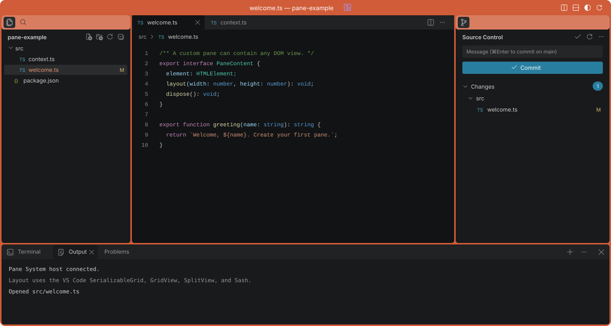

# Pane System

## Build custom workspaces with real VS Code components.

Put your input, output, files and context in one workspace.
Pane System extracts VS Code layout controls into separate TypeScript packages, with optional editor, file, Git and terminal integrations.
Your panes contain ordinary DOM views.

**[Run the demo](#run-the-demo)** · [Build a pane](#build-a-pane) · [CLI and API](#cli-sdk-and-http-api) · [API reference](docs/api/framework.md)



_Illustration redrawn from the working demo with sample data. The demo connects these views to a local host._

### Give each task its own space

A fixed screen forces users to switch between views.
Give them panes they can resize, split and rearrange.
Tabs can move between panes, open as previews, stay pinned or remain sticky.
Each pane has a separate content zoom from 50 to 200 percent.

VS Code's `SerializableGrid`, `GridView`, `SplitView`, `Sash` and editor group model provide the layout primitives.
The framework supplies the pane shell and extension API around them.
The [layout demo](http://127.0.0.1:4318/layout) runs without the editor package.

### Keep the workspace after a refresh

Reopening files and arranging panes interrupts work.
The demo saves layouts, active panes, drafts, editor positions and pane zoom in browser storage for each folder.
Saved tabs load in parallel before the workspace becomes visible.

Your application controls storage through `StoragePort` and custom view state through `serialize()`.
One theme controller supplies shared colors, dark and light presets, live preview, Apply and Cancel.

### Connect the views to real work

An editor alone does not connect files, changes and command output.
The included Bun host supplies filesystem, Git and shell adapters through typed interfaces.
Use those adapters or supply your own.

| User action        | Included behavior                                                     |
| ------------------ | --------------------------------------------------------------------- |
| Open a folder      | Browse a virtual folder tree; open files in a target pane             |
| Search a workspace | Group matches by file; filter with case, word, regex and path options |
| Follow code        | Use Command-click or F12 for TypeScript and JavaScript definitions    |
| Review a change    | Open a diff; stage, unstage and commit through the Git adapter        |
| Run a command      | Use the terminal connected to the local shell                         |

Definition navigation resolves relative imports and local workspace package exports.
The separate TypeScript worker supplies diagnostics, completion and hover information.
The [API reference](docs/api/framework.md#definition-navigation) describes its scope.

## Run the demo

Use Bun **1.4.2**, Git and ripgrep (`rg`).
The terminal also needs a local shell.

```sh
git clone https://github.com/Ansonhkg/pane-system.git
cd pane-system
bun install --frozen-lockfile
bun run dev
```

Open **[the full demo](http://127.0.0.1:4318/)** or **[the layout demo](http://127.0.0.1:4318/layout)**.
The default demo creates a sample workspace.
To open your project, select **Select folder** or restart the built host:

```sh
bun run start --workspace /path/to/project
```

For the desktop demo, run `bun run desktop --workspace /path/to/project`.
If port 4318 is in use, set `PORT=4320` before `bun run start`.

## CLI, SDK and HTTP API

`scode init` installs project settings and agent instructions.
The scode rules require CLI, SDK and HTTP interfaces for operations.
The implemented adapters provide the commands and APIs below.

| Interface            | Available scope                                                        |
| -------------------- | ---------------------------------------------------------------------- |
| Host CLI             | 21 operations for files, Git, host information and measurement storage |
| TypeScript SDK       | Pane controls, provider interfaces and `createHostClient`              |
| Host HTTP API        | `POST /api/operations`, workspace selection and saved run controls     |
| Package entry points | Package inspection through CLI, SDK and HTTP                           |

These commands use Bun source entry points; there is no installed `pane-system` executable.
Run them from the repository root:

```sh
bun packages/host/src/app/entrypoints/cli.ts files.list --root /path/to/project --input '{"path":""}'
bun packages/host/src/app/entrypoints/cli.ts files.search --root /path/to/project --input '{"search":{"query":"createWorkbench"}}'
bun packages/host/src/app/entrypoints/cli.ts git.status --root /path/to/project
```

The CLI returns JSON with saved run information.
Use `--url` and `PANE_HOST_TOKEN` to call a running host instead of opening a local ledger.
Run `bun packages/layout/src/app/entrypoints/package.ts` to inspect the layout package.

The browser SDK connects to the same host operations:

```ts
import { createHostClient } from "@pane-system/host/client";

const token = document.querySelector<HTMLMetaElement>(
  'meta[name="pane-token"]',
)!.content;
const client = createHostClient({ token });
await client.doctor();
const results = await client.files.search!({ query: "createWorkbench" });
```

For HTTP access, set `PANE_HOST_TOKEN` to the running demo's `pane-token` meta value.

```sh
curl --fail --silent --show-error http://127.0.0.1:4318/api/operations \
  -H "Authorization: Bearer ${PANE_HOST_TOKEN}" \
  -H "x-pane-token: ${PANE_HOST_TOKEN}" \
  -H 'Content-Type: application/json' \
  --data '{"id":"files.list","input":{"path":""}}'
```

See the [host command reference](docs/api/automation.md) for operation IDs, inputs, authentication and run controls.
The package inspection adapters do not expose every pane action as a remote operation.
Pane layout and editor actions also have direct TypeScript APIs.

## Build a pane

Register a view, then open it in one or more panes.
This example uses the local workspace packages in a browser application.
Give the `#workspace` container a width and height before this code runs.

```ts
import { createWorkbench } from "@pane-system/workbench";
import "@pane-system/upstream/layout.css";
import "@pane-system/tabs/styles.css";
import "@pane-system/workbench/styles.css";

const container = document.querySelector<HTMLElement>("#workspace")!;
const workbench = createWorkbench({ container });

workbench.register({
  id: "input",
  title: "Input",
  create() {
    const element = document.createElement("textarea");
    element.placeholder = "Enter context for your task";
    element.setAttribute("aria-label", "Task input");
    element.style.cssText = "width:100%;height:100%;box-sizing:border-box";
    return {
      element,
      dispose() {
        element.remove();
      },
    };
  },
});

await workbench.restore();
await workbench.open("input");
const other = workbench.split();
await workbench.open("input", undefined, other);
```

Call `workbench.dispose()` when your application removes the workspace.
Add `layout`, `focus`, `serialize` or `ready` to your view when it needs those lifecycle hooks.
See the [API reference](docs/api/framework.md) for storage, navigation, theme and host interfaces.

## Choose the packages you need

Start with layout and tabs, or use the workbench to register complete panes.
Add file and editor features when your application needs them.

| Package                                         | Purpose                                                         |
| ----------------------------------------------- | --------------------------------------------------------------- |
| [layout](packages/layout)                       | Native grid, splits, resize handles and layout serialization    |
| [tabs](packages/tabs)                           | Tab groups, preview, pinning, sticky tabs and drag movement     |
| [workbench](packages/workbench)                 | Pane registration, saved state, commands, keybindings and theme |
| [contracts](packages/contracts)                 | View lifecycle and provider interfaces                          |
| [explorer](packages/explorer)                   | Folder tree and file actions                                    |
| [editor](packages/editor)                       | Native text editor, diff editor, shared documents and save      |
| [syntax](packages/syntax)                       | Monarch syntax highlighting registrations                       |
| [language-services](packages/language-services) | Separate TypeScript worker and definition navigation            |
| [source-control](packages/source-control)       | Git changes and review controls                                 |
| [terminal](packages/terminal)                   | xterm view and terminal provider interface                      |
| [output](packages/output)                       | Output and diagnostics views                                    |
| [host](packages/host)                           | Bun filesystem, Git, PTY, HTTP and WebSocket adapters           |
| [upstream](packages/upstream)                   | Verified VS Code source, native bundles and notices             |

The packages currently ship as source workspaces and local archives.
Run `bun run pack` to build 13 archives in `dist/packages`.
See [archive installation details](docs/api/framework.md#local-commands) for Bun dependency mappings.

## Examples you can build

| Example               | Custom panes                                 | Optional integrations            |
| --------------------- | -------------------------------------------- | -------------------------------- |
| Developer tool        | Code, preview and task output                | Editor, search, Git and terminal |
| Data review workspace | Records, selected item and validation output | File provider and diagnostics    |
| Context console       | Input, context, connections and output       | Your service adapters            |

These are application examples, not bundled service integrations.
The demo's input, context and connection panes show how custom views fit into the workspace.

## Choose the starting point for your application

Layout libraries arrange views. Editor components edit source text.
Pane System combines extracted layout controls with separate packages for a connected workspace.

| Starting point                                                                                                                                                                                      | Layout and tabs                            | Source editing                        | Files, Git and shell                                     |
| --------------------------------------------------------------------------------------------------------------------------------------------------------------------------------------------------- | ------------------------------------------ | ------------------------------------- | -------------------------------------------------------- |
| Layout libraries: [Dockview](https://dockview.dev/docs/overview/introduction/), [Golden Layout](https://golden-layout.github.io/golden-layout/), [Lumino](https://lumino.readthedocs.io/en/latest/) | Included                                   | Your application adds an editor       | Built-in adapters not documented in the reviewed sources |
| Editor components: [Monaco](https://github.com/microsoft/monaco-editor#readme), [CodeMirror](https://codemirror.net/), [Ace](https://ace.c9.io/)                                                    | Your application supplies workspace layout | Included                              | Your application supplies host integrations              |
| Pane System                                                                                                                                                                                         | Extracted VS Code controls plus pane shell | Optional editor and language packages | Included local Bun adapters, or your own providers       |

_Official sources reviewed on 28 October 2026. Capabilities vary within each category._
Dockview has a [free MIT core and commercial Enterprise features](https://dockview.dev/docs/overview/licence/).
The [source catalog](docs/catalogs/market-research.json) records the reviewed capabilities and licenses.
This comparison does not establish a speed advantage over VS Code or these libraries.

## Source and scope

The archive contains **1,174 VS Code source files** at revision `ef01428f91d9b036beba1c6c1712771aec77e181`.
The build verifies the SHA-256 source manifest before compilation.
See the [source provenance](packages/upstream/vendor/provenance.json) and [MIT license](LICENSE).
Codicons use Microsoft's [CC BY 4.0 license](https://creativecommons.org/licenses/by/4.0/).
Retain the [icon attribution](packages/contracts/src/platform/browser/icons.ts) when you distribute them.

The framework does not include the VS Code extension host, marketplace, debugger or every language server.
The browser components and local host adapters have separate responsibilities.
Your application chooses the services its panes can access.

**[Run the demo](#run-the-demo)** · [Create your first pane](#build-a-pane) · [Read the API](docs/api/framework.md)
